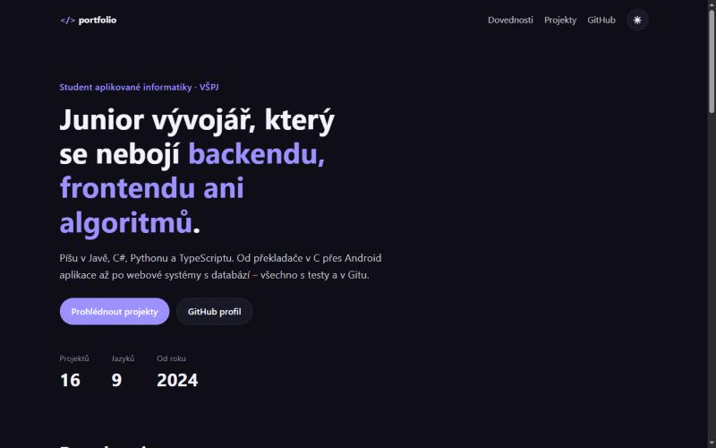
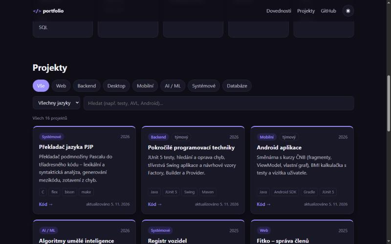

# Portfolio

[](https://github.com/neubauerlukas207-cell/neubauerlukas207-cell.github.io/actions/workflows/deploy.yml)

**Živě:** <https://neubauerlukas207-cell.github.io>

Osobní portfolio – přehled projektů s filtrováním podle kategorie a jazyka, fulltextovým hledáním, tmavým režimem a živými daty z GitHub API.




## Funkce

- **filtrování** projektů podle kategorie a jazyka + **hledání** bez ohledu na diakritiku,
- **tmavý / světlý režim** – podle systému, volba se pamatuje (bez probliknutí při načtení),
- **živá data z GitHub API** – datum poslední změny repozitáře, cache v `sessionStorage`, stránka funguje i při výpadku API,
- **responzivní** design a přístupnost (sémantické HTML, `aria-*`, ovládání klávesnicí),
- **CI/CD** – každý push na `main` spustí lint, testy, build a nasadí web na GitHub Pages.

## Technologie

React 19 · TypeScript · Vite · Vitest + Testing Library · oxlint · GitHub Actions · GitHub Pages

## Spuštění

```bash
npm install
npm run dev      # vývojový server na http://localhost:5173
npm test         # testy
npm run build    # produkční build do dist/
```

## Struktura

```
src/
  data/projects.ts        # seznam projektů (typovaná data)
  lib/filterProjects.ts   # čistá logika filtrování + testy
  hooks/useTheme.ts       # tmavý režim
  hooks/useGithubRepos.ts # načtení dat z GitHub API
  components/             # Header, Hero, Skills, Filters, ProjectCard, ProjectList
.github/workflows/        # CI/CD pipeline
```

